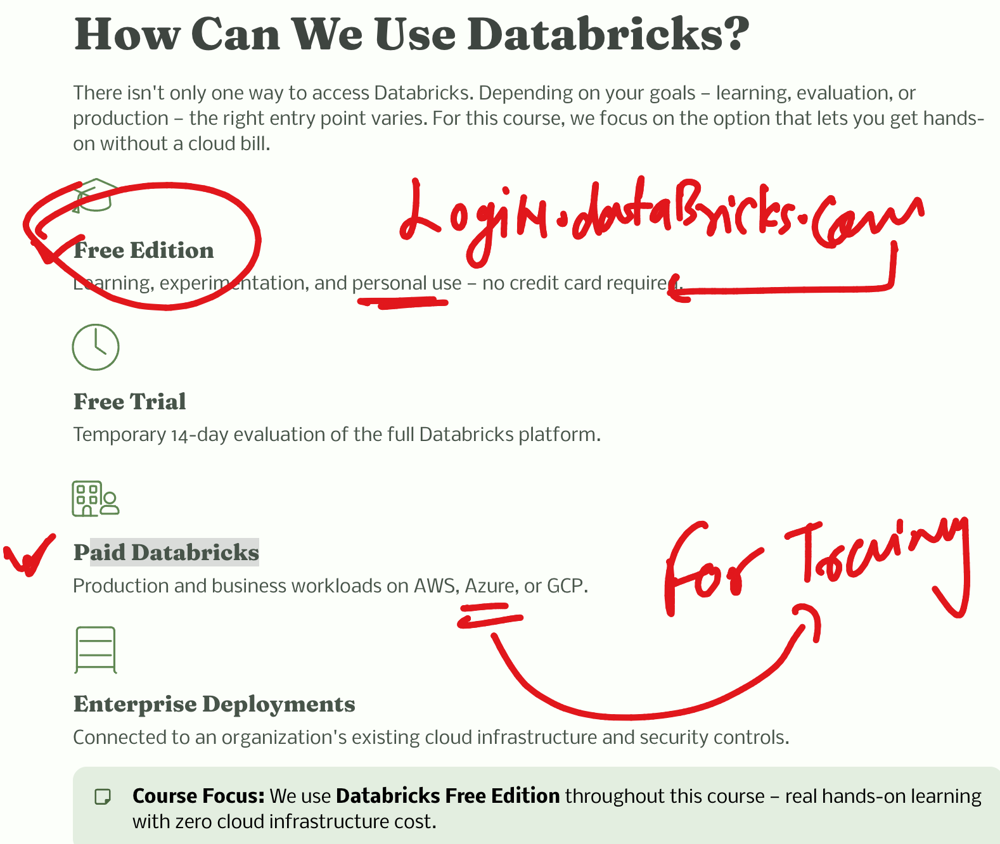
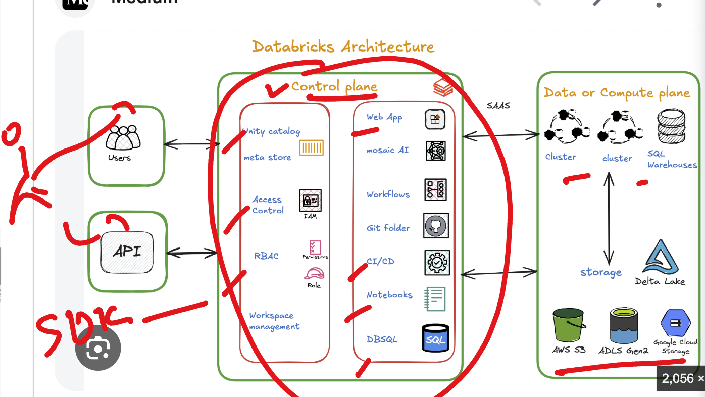
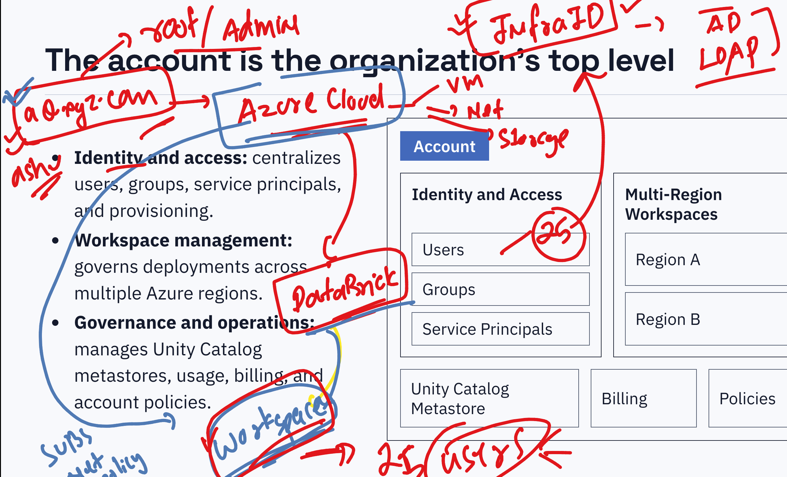
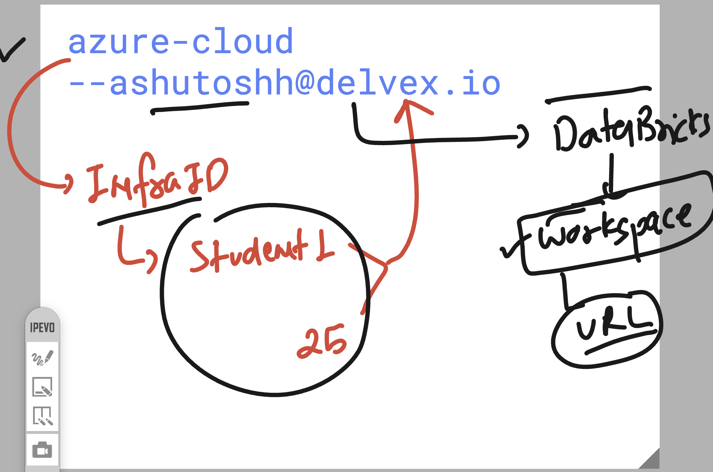

# Databricks_TataTech_16thNov2026

### Databricks -- ALl solution to Data problems

## Databricks Platform using options 

### Databricks architecture High level 

### Databricks azure platfor for this Training 

### Creating more users -- using Microsoft InfraID 

