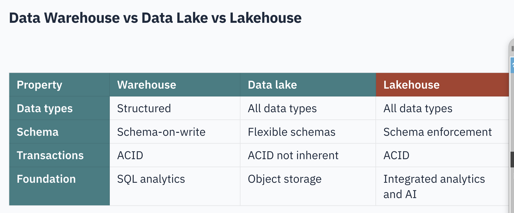
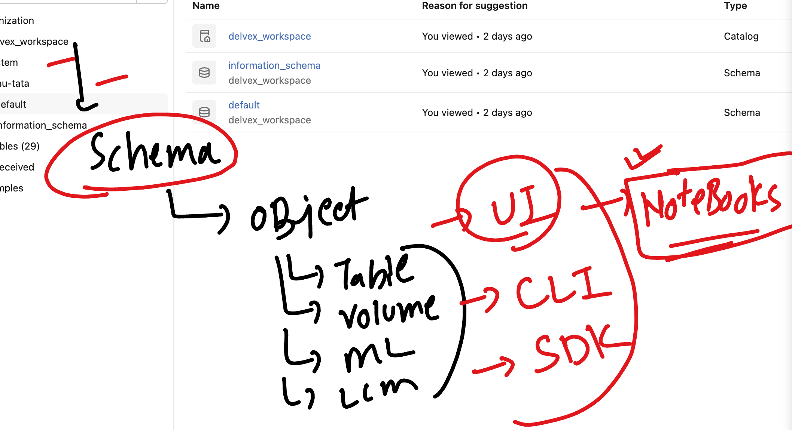
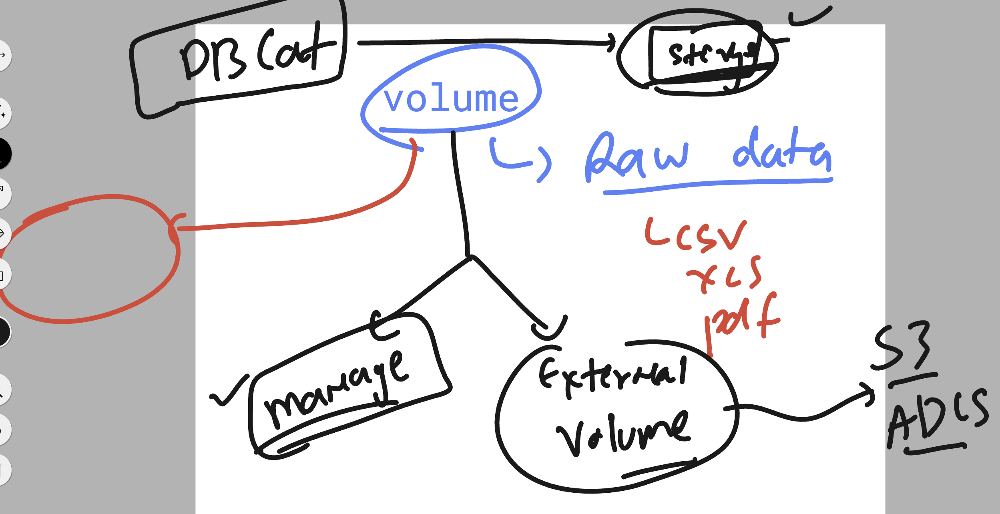

# Databricks_TataTech_16thNov2026

### data format -- data --> journey -- warehouse to lakehouse

### Creating object or handle data operation we gonna be using notebook

## volumes in databricks 

