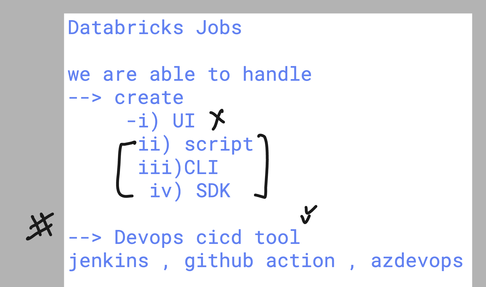
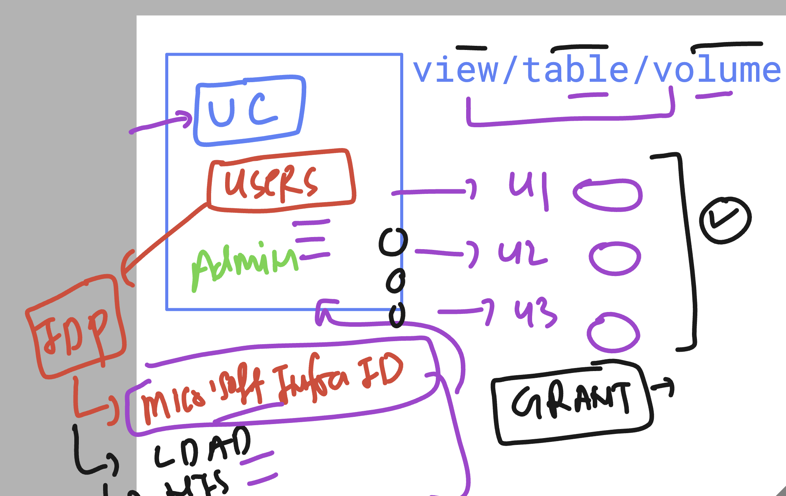

# Databricks_TataTech_16thNov2026

### databricks ops handling using given options 



### a basic understanding about Grant system in UC 



### --- GRANT option 

```
%sql
GRANT USE CATALOG on CATALOG tata_new_databricks
TO `student07@delvex.io`;

GRANT CREATE SCHEMA on CATALOG tata_new_databricks
TO `student07@delvex.io`;

```
