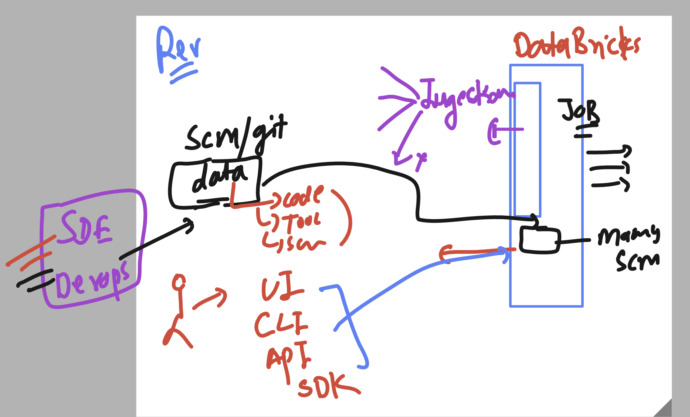

# Databricks_TataTech_16thNov2026

### Revision 



### git basic ops 

```
humanfirmware@darwin  ~  git --version 
git version 2.46.2
 humanfirmware@darwin  ~  


===>

git clone  git@github.com:redashu/Datasets.git
Cloning into 'Datasets'...
remote: Enumerating objects: 178, done.
remote: Counting objects: 100% (68/68), done.
remote: Compressing objects: 100% (59/59), done.
remote: Total 178 (delta 16), reused 34 (delta 5), pack-reused 110 (from 1)
Receiving objects: 100% (178/178), 10.21 MiB | 1.51 MiB/s, done.
Resolving deltas: 100% (51/51), done.
 humanfirmware@darwin  ~  
 humanfirmware@darwin  ~  
 humanfirmware@darwin  ~  cd  Datasets 
 humanfirmware@darwin  ~/Datasets   master  ls
advertising.csv                                              README.md
all_month.csv                                                reviews_folder.zip
amazon_online_sales.csv                                      sales.csv
annual-enterprise-survey-2023-financial-year-provisional.csv sales1.csv

===>

 git status
On branch master
Your branch is up to date with 'origin/master'.

Changes not staged for commit:
  (use "git add <file>..." to update what will be committed)
  (use "git restore <file>..." to discard changes in working directory)
	modified:   sales1.csv

no changes added to commit (use "git add" and/or "git commit -a")
 humanfirmware@darwin  ~/Datasets   master ±  
 humanfirmware@darwin  ~/Datasets   master ±  git add  sales1.csv 
 humanfirmware@darwin  ~/Datasets   master ✚  
 humanfirmware@darwin  ~/Datasets   master ✚  git add  .         
 humanfirmware@darwin  ~/Datasets   master ✚  
 humanfirmware@darwin  ~/Datasets   master ✚  git status         
On branch master
Your branch is up to date with 'origin/master'.

Changes to be committed:
  (use "git restore --staged <file>..." to unstage)
	modified:   sales1.csv

 humanfirmware@darwin  ~/Datasets   master ✚  git commit -m "sales1.csv has some change in dataset"
[master a9fbe0c] sales1.csv has some change in dataset
 1 file changed, 1 insertion(+), 1 deletion(-)
 humanfirmware@darwin  ~/Datasets  ↱ master  git push 
Enumerating objects: 5, done.
Counting objects: 100% (5/5), done.
Delta compression using up to 8 threads
Compressing objects: 100% (3/3), done.
Writing objects: 100% (3/3), 305 bytes | 305.00 KiB/s, done.
Total 3 (delta 2), reused 0 (delta 0), pack-reused 0 (from 0)
remote: Resolving deltas: 100% (2/2), completed with 2 local objects.
To github.com:redashu/Datasets.git
   6f449e7..a9fbe0c  master -> master


```